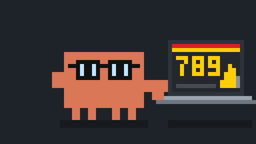

<p align="center">
  
</p>

<h1 align="center">Off Pilot</h1>

<p align="center"><b>Tira o Claude Code do piloto automático.</b></p>

Peça dez sistemas ao Claude Code e eles saem com a mesma cara: as mesmas cores, a mesma fonte, tudo arredondado, quatro cards no topo e um gráfico embaixo. O sistema de um posto e o de um mercado ficam iguais, e nenhum dos dois mostra primeiro o que importa.

O Off Pilot é um plugin que faz o Claude **pensar antes de construir**:

- **pergunta** o que muda o sistema, em vez de assumir;
- dá a cada projeto **uma cara tirada do mundo dele**: a placa de preço do posto, a etiqueta de oferta do mercado;
- põe **a informação certa no lugar certo**: o que a pessoa precisa ver primeiro, o que é secundário e o que nem devia estar na tela;
- escreve **textos de gente**, em português do Brasil.

## Como instalar

Você precisa do [Claude Code](https://code.claude.com) na versão 2.1.275 ou mais nova. Para conferir, rode `claude --version` no terminal; para atualizar, `claude update`.

### Jeito 1: dentro do Claude Code (recomendado)

1. Abra o Claude Code no terminal, em qualquer pasta.
2. Cole este comando e aperte Enter:

   ```
   /plugin install offpilot --marketplace OtavioFelix-in/OffPilot
   ```

3. O Claude Code mostra de onde vem o plugin e pede para confirmar. Confirme.
4. Escolha **Install for you** para ter o Off Pilot em todos os seus projetos.
5. Se aparecer `Run /reload-plugins to apply`, rode `/reload-plugins`.

### Jeito 2: pelo terminal do sistema

Serve também para quem usa o Claude Code no app do desktop ou no VS Code, porque os três leem a mesma instalação.

```bash
claude plugin install offpilot --marketplace OtavioFelix-in/OffPilot
```

Depois, abra uma sessão nova do Claude Code, ou rode `/reload-plugins` numa que já esteja aberta.

Se o seu Claude Code for anterior à versão 2.1.292, use dois comandos:

```bash
claude plugin marketplace add OtavioFelix-in/OffPilot
claude plugin install offpilot@offpilot
```

### Jeito 3: sem plugin

Copie as skills para a sua pasta pessoal de skills. Nesse jeito, você não recebe atualizações.

```bash
git clone https://github.com/OtavioFelix-in/OffPilot.git
cp -r OffPilot/skills/* ~/.claude/skills/
```

No Windows (PowerShell):

```powershell
git clone https://github.com/OtavioFelix-in/OffPilot.git
Copy-Item -Recurse OffPilot\skills\* $HOME\.claude\skills\
```

### Conferir se deu certo

Numa sessão do Claude Code, digite `/off`. O comando `/offpilot` tem de aparecer na lista.

### Atualizar e desinstalar

- **Receber atualizações sozinho:** rode `/plugin`, vá na aba **Marketplaces**, escolha `offpilot` e selecione **Enable auto-update**. Plugins de fora da loja oficial vêm com isso desligado.
- **Atualizar agora:** `claude plugin update offpilot@offpilot`
- **Desinstalar:** `claude plugin uninstall offpilot@offpilot`, e depois `claude plugin marketplace remove offpilot` para tirar a loja.

## Como usar

Chame `/offpilot` e diga o que você quer:

```
/offpilot faz o painel do gerente de um posto de combustível
```

O que acontece:

1. **Perguntas, uma vez só.** De duas a quatro, cada uma com um palpite para você só confirmar. Se responder "vai", ele segue com os palpites e diz o que assumiu.
2. **Uma aprovação antes do código.** Ele mostra numa mensagem só o plano visual, três opções de fonte e o desenho de cada tela.
3. **Construção.** Tudo segue o que você aprovou.
4. **Revisão do próprio trabalho.** Antes de entregar, ele procura cara de IA, informação fora de lugar e texto ruim, e corrige.
5. **Entrega.** Prints no computador e no celular, mais o que você precisa confirmar.

Também dá para chamar uma parte só:

| Comando | Para quê |
|---|---|
| `/offpilot revisa essa tela` | revisar algo pronto: lista por gravidade, antes e depois |
| `/plano-visual` | definir a cara do projeto |
| `/fontes` | escolher a fonte entre três combinações |
| `/informacao` | decidir o que vai numa tela de sistema e em que ordem |
| `/estrutura-de-pagina` | escolher o formato de uma página de site |
| `/textos` | escrever ou revisar os textos da tela |
| `/revisao` | revisar uma interface pronta |

Se outro plugin já usar algum desses nomes, use a forma completa: `/offpilot:fontes`.

## Leve e transparente

- **Não pesa:** as skills só entram no contexto quando você chama. Instalado e parado, o Off Pilot quase não gasta nada.
- **Só texto:** são arquivos Markdown. Nenhum programa, nenhuma chamada de rede, nenhum hook. Dá para ler tudo em poucos minutos.
- **Memória do projeto:** as decisões aprovadas ficam em `.offpilot/direcao.md`, na raiz do seu projeto. As próximas telas seguem o que está lá.

## Licença

[MIT](LICENSE).

Projeto independente, sem ligação com a Anthropic. O mascote é uma homenagem ao do Claude Code.
