<p align="center">
  
</p>

<p align="center">
  
  
  
  
  
</p>

<p align="center"><b>Tira o Claude Code do piloto automático.</b><br>
Você diz o que quer construir. Ele pergunta, planeja, mostra e só depois codifica.</p>

---

## O problema

Peça dez sistemas ao Claude Code e eles saem com a mesma cara: as mesmas cores, a mesma fonte, tudo arredondado, quatro cards no topo e um gráfico embaixo. O sistema de um posto e o de um mercado ficam iguais. E nenhum dos dois mostra primeiro o que importa para quem usa.

O Claude cai nisso porque **começa a fazer antes de pensar**. O Off Pilot coloca a etapa de pensar de volta:

| | No piloto automático | Com o Off Pilot |
|---|---|---|
| **Perguntas** | assume tudo e sai codando | pergunta o que muda o sistema, com um palpite pronto |
| **Visual** | as mesmas cores, fontes e cards de sempre | uma cara tirada do mundo do produto: a placa de preço do posto, a etiqueta de oferta do mercado |
| **Informação** | quatro cards, um gráfico, uma tabela | o que a pessoa precisa ver primeiro, o fato urgente no topo, o resto sai |
| **Textos** | "Bem-vindo de volta! 👋", "Ops, algo deu errado" | palavras do ramo, em português do Brasil |

## O que acontece

<p align="center">
  
</p>

1. **Perguntas, uma vez só.** De duas a quatro, cada uma com um palpite para você só confirmar. Se responder "vai", ele segue com os palpites e diz o que assumiu.
2. **Plano numa mensagem só.** A cara do projeto, três opções de fonte e o desenho de cada tela. Você aprova ou corrige.
3. **Construção.** Tudo segue o plano aprovado.
4. **Revisão.** Antes de entregar, ele revisa o próprio trabalho atrás de cara de IA, informação fora de lugar e texto ruim, e corrige.
5. **Entrega.** Prints no computador e no celular, mais a lista do que você precisa confirmar.

## As 7 skills

| Skill | O que faz |
|---|---|
| `offpilot` | A porta de entrada: entende o pedido, faz as perguntas e chama as outras na ordem certa |
| `plano-visual` | A cara do projeto: cor, forma, densidade e um detalhe-assinatura tirados do mundo do produto |
| `fontes` | Três combinações de fonte, de um acervo de 167 fontes gratuitas, fora as que viraram vício |
| `informacao` | O que aparece numa tela de sistema, em que ordem e tamanho, e o que sai |
| `estrutura-de-pagina` | O formato de uma página de site, entre 24, escolhido pelo conteúdo que existe de verdade |
| `textos` | Os textos da tela em português do Brasil: botão, erro, tela vazia, confirmação |
| `revisao` | Revisa uma tela pronta, lista os problemas por gravidade e mostra antes e depois |

## Instalar

Você precisa do [Claude Code](https://code.claude.com) na versão 2.1.275 ou mais nova. Para conferir, rode `claude --version`; para atualizar, `claude update`.

### Dentro do Claude Code (recomendado)

1. Abra o Claude Code no terminal, em qualquer pasta.
2. Cole este comando e aperte Enter:

   ```
   /plugin install offpilot --marketplace OtavioFelix-in/OffPilot
   ```

3. Confirme a origem do plugin quando o Claude Code perguntar.
4. Escolha **Install for you** para ter o Off Pilot em todos os seus projetos.
5. Se aparecer `Run /reload-plugins to apply`, rode `/reload-plugins`.

### Pelo terminal do sistema

Vale também para quem usa o Claude Code no app do desktop ou no VS Code, porque os três leem a mesma instalação.

```bash
claude plugin install offpilot --marketplace OtavioFelix-in/OffPilot
```

Depois abra uma sessão nova, ou rode `/reload-plugins` numa que já esteja aberta. Em versões anteriores à 2.1.292, use dois comandos:

```bash
claude plugin marketplace add OtavioFelix-in/OffPilot
claude plugin install offpilot@offpilot
```

### Sem plugin

Copie as skills para a sua pasta pessoal. Nesse jeito, você não recebe atualizações.

```bash
git clone https://github.com/OtavioFelix-in/OffPilot.git
cp -r OffPilot/skills/* ~/.claude/skills/
```
```powershell
git clone https://github.com/OtavioFelix-in/OffPilot.git
Copy-Item -Recurse OffPilot\skills\* $HOME\.claude\skills\
```

### Conferir, atualizar e desinstalar

- **Conferir:** numa sessão, digite `/off`. O comando `/offpilot` tem de aparecer na lista.
- **Atualizar sozinho:** rode `/plugin`, aba **Marketplaces**, escolha `offpilot` e selecione **Enable auto-update**. Plugins de fora da loja oficial vêm com isso desligado.
- **Atualizar agora:** `claude plugin update offpilot@offpilot`
- **Desinstalar:** `claude plugin uninstall offpilot@offpilot` e, para tirar a loja, `claude plugin marketplace remove offpilot`.

## Usar

```
/offpilot faz o painel do gerente de um posto de combustível
```

Também dá para chamar uma parte só: `/offpilot revisa essa tela`, `/fontes`, `/textos`, `/informacao`, `/estrutura-de-pagina`, `/plano-visual` ou `/revisao`. Se outro plugin já usar algum desses nomes, use a forma completa, como `/offpilot:fontes`.

## O que ele não faz

- Não escreve código antes de você aprovar o plano.
- Não entra sozinho: só roda quando você chama.
- Não inventa número, depoimento, cliente nem foto. Faltou dado, ele pergunta ou deixa marcado "[a confirmar]".
- Não troca a cara de um projeto que já tem uma. Revisar não é refazer.
- Não decide por você o que você já pediu. O seu pedido vence qualquer regra dele.

## Leve e transparente

- **Não pesa:** as skills só entram no contexto quando você chama. Instalado e parado, quase não gasta nada.
- **Só texto:** arquivos Markdown. Nenhum programa, nenhuma chamada de rede, nenhum hook.
- **Memória do projeto:** as decisões aprovadas ficam em `.offpilot/direcao.md`, na raiz do seu projeto, e as próximas telas seguem o que está lá.

## Licença

[MIT](LICENSE).

> Projeto independente, sem vínculo com a Anthropic. "Claude" e "Claude Code" são marcas da Anthropic. O mascote e as ilustrações da capa foram feitos para este projeto.
